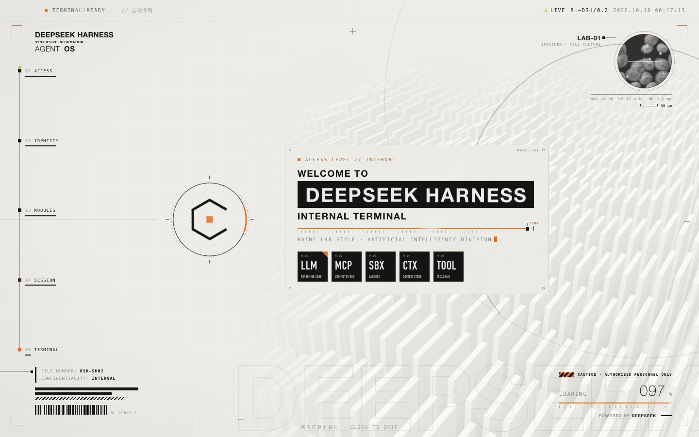
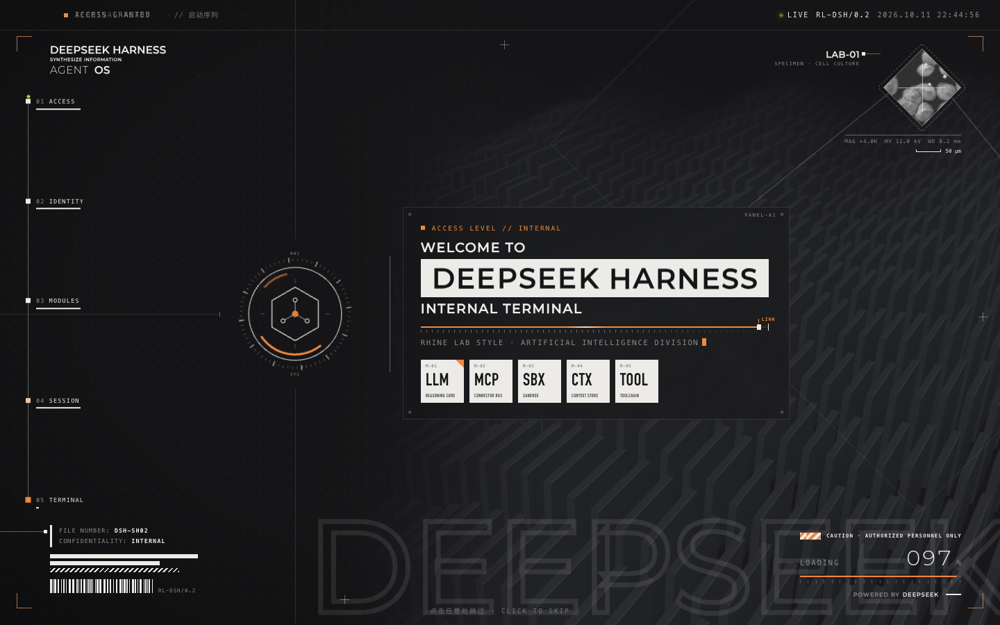
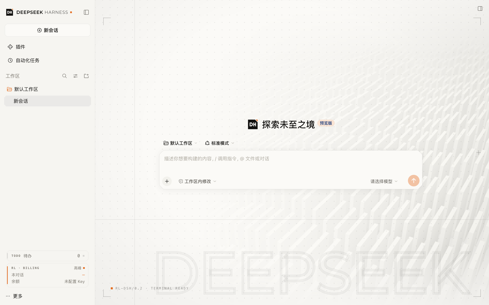
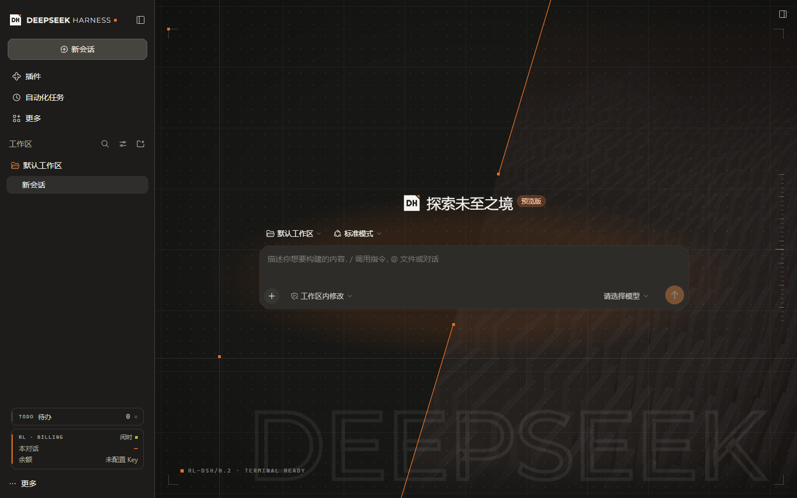

<div align="center">


# 莱茵生命主题

DeepSeek Harness 的莱茵生命风格主题，包括开屏动画、界面配色和品牌标志。

[](https://github.com/Respawn-ID/dsh-rhine-splash/releases)
[](LICENSE)
[](#环境要求)

[安装](#安装) · [界面主题与品牌标志](#界面主题与品牌标志) · [附加功能](#附加功能) · [配置](#配置) · [开屏动画](#开屏动画) · [常见问题](#常见问题) · [开发](#开发) · [更新日志](CHANGELOG.md)

</div>

## 简介

莱茵生命主题（`dsh-rhine-splash`）是 DeepSeek Harness 的第三方组合包，适用于桌面版和网页版。

安装后，每次启动 Harness 都会先播放一段约 4.5 秒的开屏动画，再进入主界面。主界面的配色、圆角和 Logo 也会换成莱茵生命风格。开屏动画、界面主题和品牌标志可以分别开关。

插件还在 Harness 中加入了几项小功能：对话运行结束或等待授权时的莱茵通知、集中查看各对话状态的待办中心、空白会话页的背景、窗口切回前台时的动效、侧栏对话的莱茵风格状态点、输入框旁的推理强度滑块和「即答」开关、侧栏左下角的对话费用与账户余额（点开是完整的费用页面），以及归档对话的取消归档和永久删除。

设计参考了《明日方舟》特别映像「莱茵生命：访问」。所有图形均为原创，不包含游戏官方素材。

| | 浅色 | 深色 |
| --- | --- | --- |
| 开屏动画 |  |  |
| 主界面 |  |  |

开屏动画截图来自本仓库的预览页面。主界面截图来自 DeepSeek Harness 网页版 0.2.1-rc.2 的全新配置（未登录、未配置 API Key），使用默认的莱茵橙强调色和暖白底色，空白页背景为「完整开屏底」，左下角是待办条和计费卡片。由于没有可用的模型，截图中不显示推理强度滑块。

## 环境要求

- DeepSeek Harness 桌面版（macOS、Windows）或网页版 0.2.1-rc.3。
- 在网页版中通过命令行安装时，终端里需要能使用 `pnpm`。

## 安装

你可以从 GitHub、发布包或本地目录安装。下面步骤中的 `<来源>`，请替换为以下任意一种：

- **GitHub**：`github:Respawn-ID/dsh-rhine-splash`。如需指定版本，在末尾加上版本标签，例如 `github:Respawn-ID/dsh-rhine-splash#v0.2.7`。
- **发布包**：从 [Releases](https://github.com/Respawn-ID/dsh-rhine-splash/releases) 下载 `dsh-rhine-splash-<版本>.tgz`，填写文件的绝对路径。无法访问 GitHub 时，建议使用这种方式。
- **本地目录**：克隆本仓库后，填写仓库的绝对路径。适合需要修改代码的情况。

本组合包没有依赖，也不运行安装脚本，因此安装时不会要求你确认版本豁免或允许构建脚本。

下文说的「完全退出 Harness」：

- **macOS**：按 <kbd>⌘</kbd> + <kbd>Q</kbd>。
- **Windows**：关闭窗口只会把 Harness 缩到系统托盘，任务还在后台运行。请在 Harness 的应用菜单中选择「退出」，或在系统托盘中右键 Harness 图标，选择「退出 DeepSeek Harness」。

### 在插件页安装

1. 在 Harness 侧栏点击 **插件**，然后点击 **添加插件**。
2. 输入 `<来源>`，点击 **安装**。安装完成后，点击 **立即启用**。
3. 完全退出 Harness，然后重新打开。

### 让 dsh agent 安装

1. 以本仓库目录为工作区新建会话，并切换到 **Creator** 预设。
2. 告诉 agent「安装这个插件」。agent 会按照 [`AGENTS.md`](AGENTS.md) 中的说明完成安装，每一步都会请你批准。
3. 安装完成后，完全退出并重新打开 Harness。

### 使用命令行安装

1. 如果终端里还没有 `dsh` 命令，先在 Harness 中安装：macOS 在菜单栏中选择 **DeepSeek Harness** > **管理 dsh 命令…**，Windows 在 Harness 的应用菜单中选择 **管理 dsh 命令…**，然后点击 **安装**。
2. 完全退出 Harness。Harness 运行时会锁定配置，命令行无法写入。
3. 运行以下命令。路径中有空格时，请保留引号：

   ```bash
   dsh plugin --profile desktop add "<来源>"
   ```

4. 重新打开 Harness。

### 在网页版中安装

1. 停止正在运行的 `dsh web`。
2. 运行以下命令：

   ```bash
   dsh plugin --profile web add "<来源>"
   ```

   dsh 会调用 pnpm 安装插件。如果提示找不到 pnpm，请先安装 pnpm。

3. 重新运行 `dsh web`，在浏览器中打开终端显示的地址。

网页版的配置和卸载方法与桌面版相同，只需把命令和路径中的 `desktop` 换成 `web`。

### 确认安装成功

打开 **插件** 页面，在「已安装」中能看到「莱茵生命主题」，并且开关已打开，就说明安装成功了。

### 更新

Harness 目前不支持自动更新组合包。要升级到新版本，请先卸载旧版本，再安装新版本。如果是从本地目录安装的，修改代码后重启 Harness 即可生效。

各版本的变化请查看[更新日志](CHANGELOG.md)。

### 卸载

在 **插件** 页面打开「莱茵生命主题」，点击 **卸载**，然后重启 Harness。如果只是想暂时停用，关闭开关即可。

也可以退出 Harness 后，在终端中运行：

```bash
dsh plugin --profile desktop remove dsh-rhine-splash
```

## 界面主题与品牌标志

除了开屏动画，插件还会调整 Harness 主界面的外观。

界面主题会把默认的冷灰色调换成暖白（浅色模式）和暖炭黑（深色模式），把 DeepSeek 蓝换成莱茵橙，并把圆角改为切角。主题会跟随 Harness 的深浅色设置。它只修改 Harness 的设计变量，不改动具体组件，因此 Harness 更新后通常仍能正常显示。

配色可以在设置页「外观」中调整，改完立即生效：

- **强调色**：莱茵橙（默认）、生命绿、深海蓝、绯红，或者用取色器自定义任意颜色。链接、按钮、你的消息气泡、侧栏选中项，以及通知、待办、计费卡片里的强调色都会一起变化。插件会根据所选颜色推算出整套深浅色阶，开屏动画也使用同一个颜色。
- **底色**：暖白（默认）、中性灰，或者保留 Harness 原版的冷灰。

品牌标志会替换侧栏左上角和空白会话页中的 Logo，有两种样式可选：

- **模块铭牌**（`plate`，默认）：黑色切角方块上的几何字母「DH」，右上角带一个橙色标记。
- **开放细胞**（`cell`）：缺了一条边的六边形，中间是一个橙色方点。

关闭品牌标志，或者停用、卸载本插件后，Harness 会恢复官方的鲸鱼标志。

## 附加功能

这些功能都可以在设置页单独关闭，删除归档对话除外。

### 空白页背景

新建会话、还没发消息时，空白会话页会铺上一层莱茵风格的背景。三种样式共用同一套界面框架，和切回动效的细线风格一致，并跟随你选的强调色：四角定位框（左上角带强调色方块）、右侧边缘的刻度尺、左下角的「RL-DSH/0.2 · TERMINAL READY」状态行。三种可选：

- **档案网格**（`grid`）：点阵叠在每 5 格一条的淡色大网格上，输入框周围的网格稍稍淡一些；底部一行巨大的描边「DEEPSEEK」。
- **板条阵列**（`bars`）：一条对角线把空白页斜着劈成两半，右半边是开屏里的立体板条图，左半边是点阵。对角线是一条粗细均匀的强调色细线，在标题和输入框所在的高度断开，两个断点各有一个小方块指向输入框，起到视线引导的作用；输入框周围的板条会淡下去，顶端标注「PANEL 07 · STRUCTURE」。每次进入空白页时，对角线会从上下两端向输入框画过来，线条落定时两个小方块随之出现，不到 1 秒就结束，之后保持静止。
- **完整开屏底**（`full`）：网格、对角分割的板条和描边字全部叠加，再加两条细引导线（交点处一个强调色方块），接近开屏最后一帧的淡化版。

三种样式都有一圈很淡的强调色光晕贴着输入框，四周略微压暗，把视线收向输入框。光晕在进入空白页时淡入并从输入框向外轻轻扩开一次（板条阵列和完整开屏底里随对角线落定时出现），之后保持静止。

对角线、断点、光晕和输入框周围的留白都以标题和输入框为基准定位，窗口放大缩小、调整窗口比例或缩放界面（Ctrl + / Ctrl −）时，断点的小方块始终贴着标题上方和输入框下方，斜线角度也保持不变。

默认每次启动随机选一种，不与上一次重复。背景只在空白页显示，开始对话后自动消失，深浅色都会适配。不需要时，在设置页把「空白页背景」设为「关闭」。

### 切回动效

把 Harness 放到后台再切回来时，窗口上会播放一段很短的动效，有三种可选：

- **链路恢复扫描**（`scan`，约 1 秒）：一道橙色细线带着「SYNC 00%→100%」读数从上往下扫过，扫过的地方短暂显出点阵网格；四角的定位框带着小方块收拢锁定，右下角显示「LINK RESTORED」和一条展开的细线。
- **六边形光圈**（`iris`，约 1.2 秒）：画面先蒙上一层半透明的磨砂点阵（界面隐约可见），中央的开放细胞徽记在旋转的刻度环里亮起，下方显示「RHINE LAB · RESUMING」；随后从徽记处打开一个双细线描边的六边形窗口露出界面，和开屏的光圈退场一样。
- **故障闪切**（`glitch`，约 0.6 秒）：画面闪过扫描线，几道横条错位并改变底下内容的明暗和饱和度，伴随橙青两色错开的细线，右下角闪出「SIGNAL RESYNC」，随即复原。

默认每次随机播放一种，不与上一次重复。动效不会挡住点击和输入。什么时候算「切回来」由「切回触发」决定：

- **最小化或隐藏后**（`hidden`，默认）：只有窗口被最小化、隐藏（macOS 的「隐藏」，或 Windows 上关闭窗口缩到系统托盘）或切到别的桌面后再回来才播放。只是点到别的窗口再点回来不会触发。
- **离开 30 秒后**（`away`）：切到别的应用、最小化或隐藏，离开超过 30 秒再回来时播放。来回快速切换不会触发。
- **每次切回**（`always`）：窗口每次重新获得焦点都播放。

设置页的「预览切回动效」可以直接看效果。系统开启「减弱动态效果」时不播放。不需要时，把「切回动效」设为「关闭」。

### 莱茵通知

对话运行结束，或者正在等你授权、回答问题时，插件会提醒你。设置页「通知时机」决定哪些情况会提醒，三项默认都打开：

- **当前对话**（`notifyCurrent`）：你正在查看的对话。
- **其他对话**（`notifyOthers`）：你在 Harness 里，但看的是别的对话。
- **应用失焦或在后台**（`notifyAway`）：你切到了别的应用，或 Harness 被最小化、隐藏。

「通知方式」决定怎么提醒：

- **系统通知**（`notifySystem`）：窗口不在前台时，通过系统通知弹出提醒（macOS 显示在通知中心，Windows 显示在通知区域），内容是对话标题和状态（「运行结束」「等待授权」「等待回答」「计划待审」），不包含对话内容。点击通知会回到 Harness 并打开这个对话。Windows 桌面版的系统通知由插件以 DeepSeek Harness 的名义直接发给 Windows（Harness 自带的网页通知在 Windows 上显示不出来），点击通知会把 Harness 切到前台，对应的界面内提示卡片会在那里等你点开。
- **界面内提示**（`notifyToast`）：在窗口右上角弹出半透明的毛玻璃提示卡片。卡片出现时从左侧色条扩散出两道波纹，状态小方块向外发出方形波纹（等待授权时持续扩散），点击时从点按位置漾开一圈水波。点击即可跳到对应对话，约 8 秒后自动消失（鼠标停留时暂停）。窗口失焦但仍在屏幕上时立即显示；窗口被隐藏或最小化时，提示会等你回来再显示。
- **提示音**（`notifySound`）：运行结束时两声上扬的短音，等待授权时三声短促提示。

系统通知只在应用失焦或在后台时发送；在 Harness 里时用界面内提示。各项都可以在设置页分别关闭，「预览通知」可以直接看效果。如果桌面版收不到系统通知，请在系统设置中允许 DeepSeek Harness 发送通知：macOS 在「系统设置 → 通知」中，Windows 在「设置 → 系统 → 通知」中。网页版首次使用系统通知时，点「预览通知」后浏览器会请求通知权限；如果系统或浏览器拒绝了通知权限，界面内提示和提示音不受影响。

### 待办中心

侧栏左下角、计费卡片上方会多出一条「TODO 待办」。右侧的数字是需要你看一眼的对话数，也就是「等你处理」和「已完成未查看」两组的总和。有对话在等你时，数字和左侧色条是橙色；只剩已完成未查看时，色条是绿色。

点它会弹出待办面板，按三组列出对话：

- **等你处理**：等待授权（注明是哪个工具）、计划待审和等待回答的对话。
- **已完成未查看**：跑完了但你还没打开看的对话。打开对话后它就会从这里消失，和侧栏里的未读标记一致。
- **运行中**：正在运行的对话，不计入数字。

每一行显示对话标题、状态和持续了多久，点一下即可打开那个对话。面板可以用方向键选择、回车打开、<kbd>Esc</kbd> 关闭。有对话在运行时，待办条上还会注明「N 个运行中」。侧栏收起时，入口变成一个带数字角标的图标。在会话中输入 `/todo` 也能列出同样的对话。

时长从插件看到状态变化时开始计算。重启 Harness 之前就在等待或已完成的对话，按它最近一次更新的时间估算；这类运行中的对话不显示时长。不需要时，可以在设置页关闭「待办中心」。

### 对话行状态

Harness 会在侧栏对话标题左边显示状态点（等你处理、运行中、已完成未查看；空闲的对话不显示）。插件把它们换成莱茵风格：等你处理是带脉冲的橙色方点，运行中是细橙色转圈，已完成未查看是绿色方点；判断逻辑仍是 Harness 自己的。

鼠标停在对话上时，Harness 的悬停卡片里会多一行时长，例如「已等待 3 分钟」「已运行 5 分钟」「8 分钟前完成」，计时方式与待办中心相同。状态点的新样式只在开启「界面主题」时生效。不需要时，可以在设置页关闭「对话行状态」。

### 推理强度滑块

输入框右下角、模型选择器左边会多出一个推理强度按钮，显示当前档位。点开后拖动滑块或点击刻度即可切换推理强度，也可以用方向键调整。DeepSeek 模型有关闭、低、高、最高四档；其他模型按它们提供的档位显示。

按钮左边是「⚡ 即答」开关，参照 Claude Code 的思考开关和 DeepSeek 网页版的「深度思考」按钮：点一下把当前对话的推理强度设为「关闭」，模型跳过思考、直接回答，开关亮起强调色；再点一下回到开启前的档位（按模型分别记住，没有记录时回到模型的默认档）。在对话里按 Alt+T（macOS 为 Option+T）也能切换。滑块拖到「关闭」时开关同样亮起，两者是同一个设置。只有支持关闭思考的模型才显示这个开关。

模型运行时，对话里「深度求索中，用时 … 秒」那一行的文字后面会出现橙色的「⚡ 立即回答」。这一行总在最新内容的下方，所以按钮会跟着思考过程往下走；滚出视野时隐藏，运行结束就消失。DeepSeek 在一次请求中途无法关闭思考，所以点击后插件会先把推理强度切到「关闭」，中断这次回复，等对话停下后自动补发一条「跳过思考，直接回答上面的问题。」，模型就会不思考直接作答。这条补发的消息在对话里是隐藏的；回答结束后推理强度自动恢复为原来的档位（如果你在此期间自己改了档位，则保留你的选择）。被中断的那段思考仍会保留并标为已中断。

面板使用 Harness 原生菜单的材质，按钮和滑块参照 Claude Code 的推理强度选择器：灰色渐变轨道上用小圆点标出各档，模型的默认档用竖线标出并在下方注明「默认」。切到最高档时，已选部分变成像素点阵：远离把手的点稀疏、呈灰色，越靠近把手越密越亮并转为橙色；每个点留在原位、像呼吸一样缓慢明暗起伏，一口口呼吸从把手处鼓起、向外推开，档位文字变为橙色。滑块和模型选择器里的「推理等级」改的是同一个设置，两边会保持一致。系统开启「减弱动态效果」时不播放这些动画。不需要时，可以在设置页关闭「推理强度滑块」。

### 计费与余额

侧栏左下角会显示一张小卡片：「本对话」是当前打开的对话已经花掉的钱，「余额」是 DeepSeek 账户剩余的余额，右上角标出现在是高峰还是闲时。

- 本对话的费用按 DeepSeek 官方价格估算：按所用模型和当时所处时段的单价，把缓存命中、未命中和输出 token 分别计价，闲时按半价算，不计节假日。第一次看到一个已经用过的对话时，之前的用量按当前时段单价一次性估算。鼠标停在这一行上可以看到 token 明细。
- 余额由插件在 Harness 后台用你在 Harness 里配置的 DeepSeek API Key 向 DeepSeek 官方余额接口查询，每分钟最多查一次。API Key 只在后台使用，不会传到界面。没有配置 API Key 时显示「未配置 Key」。
- 点击这张卡片默认直接打开费用页面，占满主区域；点「返回对话」、再点一次卡片或打开任意对话即可回到对话。如果更喜欢先看一眼，可以在设置页「工具」把「点击计费卡片」改为「先弹出小卡片」：点卡片会在左下角弹出小面板，列出本对话、今日和近 7 天（可切换为近 30 天）的花费、每日柱状图、按模型占比、花费最多的对话和预算；点其中的柱状图或底部的「完整页面」再进入费用页面。
- 费用页面顶部可以切换今日、近 7 天、近 30 天和近 62 天，下面所有数字都按所选范围统计：
  - **总览**：区间花费（与前一个同样长的时段相比的涨跌）、日均、缓存命中率和命中省下的钱、闲时半价省下的钱，以及账户余额和按近 7 天日均估算还能用几天；
  - **每日花费**：按模型分色的柱状图，设置了每日预算时画出预算线；选「今日」时改为每小时花费。鼠标停在柱子上或用方向键可以看到当天明细，右上角可以切换为表格；
  - **按模型**：各模型的花费、占比、缓存命中率和每百万 token 的平均花费；
  - **花费构成**：输出、未命中缓存的输入、命中缓存的输入各花了多少；
  - **时段分布**：一天中各小时的花费，标出工作日峰时（原价）；
  - **花费最多的对话**：标题、工作区、模型、花费和最近活动，点击即可打开；已删除的对话也会保留它的花费；
  - **预算**：今日用量、超出每日预算的天数和超出单个对话预算的对话数，可以直接点「上限」修改；
  - **按工作区**：各工作区的花费和对话数。
- 预算分「每日」和「单个对话」两种，可以在费用页面或小面板里点「上限」直接修改，也可以在设置页「工具」中填写，0 表示不提醒。花费达到上限的 80% 和超过上限时，各用莱茵通知提醒一次，只在真正产生新花费时检查，不会拦住对话。
- 所有已加载、正在运行的对话都会在后台实时记账，不必打开对话。按天统计从 0.2.4 开始，按小时和峰时 / 闲时的统计从 0.2.5 开始，最多保留最近 62 天。所有记录只保存在本机。
- 不需要时，可以在设置页关闭「计费与余额」。

### 删除归档对话

Harness 本身只能归档对话，不能删除。安装本插件后，已归档对话的「…」菜单最下方会多出红色的「删除对话」。点击后会弹出警告，说明这个对话将被永久删除、无法恢复；点「永久删除」才会执行，点「取消」或按 Esc 则不做任何改动。

- 删除是永久的：对话的记录文件夹会被直接删除，不经过废纸篓，无法找回。
- 删除立即生效，对话马上从侧栏、搜索和归档列表中消失，不需要重启 Harness。
- 只能删除已归档的对话。
- 本次启动后打开过的对话会一直被 Harness 占用到退出，无法立即删除。这时只需点一次删除：插件会记下它，下次启动 Harness 时在任何窗口打开它之前自动永久删除，不需要再点第二次。在此之前取消归档，则取消这次删除。

要批量整理时，打开 Harness 的「设置 → 归档对话」。这一页按最近更新时间列出所有归档对话（标题、所在工作区和日期）。勾选或全选后：

- 点「取消归档」，所选对话会立即回到侧栏，不需要确认；
- 点「删除所选」，会弹出同样的警告，确认后逐个删除并显示进度；本次打开过的对话会在下次启动时自动删除。

## 配置

### 在 Harness 中设置

在 **插件** 页面打开「莱茵生命主题」，再点击同名组件，即可进入设置页面。选项按开屏、文字、外观、动效、通知时机、通知方式、工具分组，你可以在这里修改所有选项，并随时预览开屏动画、切回动效和通知。修改会立即保存（文字和时长在输入框失去焦点或按回车时保存）；页面底部的「恢复默认」会立即把所有改过的选项恢复为默认值。「预览开屏」按当前设置播放。

在会话中输入 `/splash`，也可以预览开屏动画或修改常用选项。

除了「开屏」和「文字」两组，其他设置都会立即生效，不需要重启：界面主题和配色、品牌标志、空白页背景、切回动效、通知，以及推理强度滑块、计费卡片、待办中心和对话行状态的开关。开屏动画只在启动时播放，所以「开屏」和「文字」两组在下次启动时生效，改完可以用「预览开屏」立即查看效果。如果只想关闭开屏动画、保留界面主题，关闭「开屏动画」开关即可。

### 编辑配置文件

你也可以直接编辑 `~/.dsh/profiles/desktop/cordis.patch.yml`（网页版为 `~/.dsh/profiles/web/cordis.patch.yml`；Windows 上 `~` 指 `%USERPROFILE%`，即 `C:\Users\<用户名>`）。保留文件原有内容，在末尾添加类似下面的配置，保存后重启 Harness：

```yaml
- id: rhine-splash
  config:
    exit: iris
    duration: 5000
```

请注意：

- 这里的 `config` 会整体替换默认配置，没有写出的选项会恢复为默认值。
- 颜色值需要加引号，例如 `'#e46f24'`，否则 `#` 后面的内容会被当作注释。
- 无法识别的选项和无效的值会被忽略，并使用默认值。

| 选项 | 默认值 | 说明 |
| --- | --- | --- |
| `enabled` | `true` | 是否播放开屏动画。关闭后，界面主题和品牌标志不受影响 |
| `uiTheme` | `true` | 是否使用莱茵界面主题 |
| `brand` | `true` | 是否替换品牌标志 |
| `logo` | `plate` | 标志样式：`plate`（模块铭牌）或 `cell`（开放细胞） |
| `accent` | `rhine` | 强调色：`rhine`（莱茵橙）、`life`（生命绿）、`ocean`（深海蓝）、`crimson`（绯红）或 `custom`（使用 `accentColor`）。界面和开屏共用 |
| `accentColor` | `'#e46f24'` | 自定义强调色，3 位或 6 位十六进制，仅在 `accent` 为 `custom` 时使用 |
| `base` | `warm` | 底色：`warm`（暖白）、`neutral`（中性灰）或 `official`（Harness 原版冷灰） |
| `effortSlider` | `true` | 是否在输入框旁显示推理强度滑块 |
| `billing` | `true` | 是否在侧栏左下角显示本对话费用和账户余额 |
| `costOpen` | `page` | 点击计费卡片时：`page` 直接打开费用页面，`popup` 先在左下角弹出小面板，点其中的柱状图或「完整页面」再进入费用页面 |
| `todoCenter` | `true` | 是否在侧栏左下角显示待办中心，参见[待办中心](#待办中心) |
| `rowStatus` | `true` | 是否使用莱茵风格的对话行状态点，并在悬停卡片中显示时长，参见[对话行状态](#对话行状态) |
| `budgetDaily` | `0` | 每日预算，按账户余额的币种计算，最多两位小数；0 表示不提醒，参见[计费与余额](#计费与余额) |
| `budgetSession` | `0` | 单个对话的预算，规则同上 |
| `heroBackground` | `random` | 空白页背景：`random`（每次启动随机）、`grid`、`bars`、`full` 或 `off`，参见[空白页背景](#空白页背景) |
| `resumeEffect` | `random` | 切回动效：`random`（每次随机）、`scan`、`iris`、`glitch` 或 `off`，参见[切回动效](#切回动效) |
| `resumeTrigger` | `hidden` | 什么时候播放切回动效：`hidden`（最小化或隐藏后）、`away`（离开 30 秒后）或 `always`（每次切回） |
| `notifyCurrent` | `true` | 正在查看的对话运行结束或等待授权时是否提醒 |
| `notifyOthers` | `true` | 在 Harness 里查看其他对话时，后台对话的状态是否提醒 |
| `notifyAway` | `true` | 应用失焦或在后台时是否提醒 |
| `notifySystem` | `true` | 窗口不在前台时，对话运行结束或等待授权是否发送系统通知，参见[莱茵通知](#莱茵通知) |
| `notifyToast` | `true` | 是否显示界面内的通知卡片 |
| `notifySound` | `true` | 是否播放提示音 |
| `title` | `DEEPSEEK HARNESS` | 开屏主标题，最多 80 个字符 |
| `subtitle` | `RHINE LAB STYLE · ARTIFICIAL INTELLIGENCE DIVISION` | 开屏副标题，最多 80 个字符 |
| `code` | `RL-DSH/0.2` | 开屏角落显示的编号，最多 80 个字符 |
| `accentLight`、`accentDark` | `'#e46f24'`、`'#f0893e'` | 旧版的开屏强调色，已由 `accent` 取代。如果配置文件里还设置了与默认不同的 `accentLight`，且 `accent` 保持默认，插件会把它当作自定义强调色继续使用 |
| `theme` | `auto` | 开屏配色：`auto` 跟随界面的深浅色，也可以设为 `light` 或 `dark`。只影响开屏动画，界面深浅色请在 Harness「设置 → 通用 → 外观」中切换 |
| `exit` | `random` | 退场动画：`random`（随机）、`doors`、`decode`、`glitch` 或 `iris`，参见[退场动画](#退场动画) |
| `duration` | `4500` | 开屏的最短播放时长，单位为毫秒，范围 0–15000。动画节奏会随之整体缩放 |
| `maxWait` | `8000` | 等待主界面加载的最长时间，单位为毫秒，不小于 `duration`，最大 20000 |
| `skippable` | `true` | 是否允许跳过开屏动画 |
| `replayOnReload` | `false` | 刷新页面时是否重新播放 |

## 开屏动画

开屏动画分为两段。第一段是身份验证：屏幕中央的 `REQUESTING ACCESS` 逐字变成 `PERMISSION AUTHORIZED`，四周的状态栏、样本窗口和档案信息依次出现。第二段是欢迎页：屏幕中央显示 `WELCOME TO DEEPSEEK HARNESS`，下方的模块方块依次翻入，加载进度接近 100%。最后播放一段退场动画，进入主界面。

### 退场动画

默认每次随机播放一种，并且不会和上一次重复。你也可以用 `exit` 选项固定其中一种：

| `exit` | 名称 | 效果 |
| --- | --- | --- |
| `doors` | 舱门 | 一道橙色光缝展开，画面像舱门一样上下分开 |
| `decode` | 代码消散 | 画面变成满屏字符，然后逐格清除 |
| `glitch` | 故障撕裂 | 画面被切成横条，错位、闪烁后消失 |
| `iris` | 六边形光圈 | 周围画面变暗，中央徽记亮起，随后从徽记处打开一个六边形窗口 |

### 播放规则

- 开屏动画至少播放 `duration` 设定的时长，并在主界面加载完成后退场。如果主界面一直没有加载完成，最多等待 `maxWait` 后也会退场。
- 点击屏幕任意位置，或者按 <kbd>Esc</kbd>、<kbd>Enter</kbd>、空格键，都可以跳过动画。
- 每次启动只播放一次，刷新页面不会重播。如果希望刷新时也播放，请将 `replayOnReload` 设为 `true`。
- 如果系统开启了「减弱动态效果」，开屏只显示静态画面，并在大约 1 秒后淡出。
- 窗口较小时，部分装饰元素会自动隐藏。

## 常见问题

**安装后没有看到开屏动画**

开屏动画只在 Harness 启动时播放。请确认插件已启用，然后[完全退出 Harness](#安装)，再重新打开。只关闭窗口或刷新页面，不会触发开屏动画；Windows 上关闭窗口只会缩到系统托盘。

**命令行提示 `Open DeepSeek Harness Desktop once to initialize its profile, then fully quit it`**

这说明 Harness 还没有初始化过配置，或者仍在运行。请先打开一次 Harness，然后完全退出，再重新运行命令。

**终端里找不到 `dsh` 命令**

在 Harness 中安装 `dsh` 命令：macOS 在菜单栏中选择 **DeepSeek Harness** > **管理 dsh 命令…**，Windows 在 Harness 的应用菜单中选择 **管理 dsh 命令…**，然后点击 **安装**。

在 macOS 上也可以直接使用完整路径：

```bash
"/Applications/DeepSeek Harness.app/Contents/Resources/runtime/cli/bin/dsh" plugin --profile desktop add "<来源>"
```

**从 GitHub 安装失败**

通常是因为网络无法访问 GitHub。请从 [Releases](https://github.com/Respawn-ID/dsh-rhine-splash/releases) 下载发布包，改用文件路径安装。

**选了深色，重启后界面还是浅色**

本插件设置页里的「开屏配色」只控制开屏动画的深浅色。界面的深浅色由 Harness 自己管理，请在 Harness 的「设置 → 通用 → 外观」中选择「深色」；默认的「跟随系统」会随 macOS 的外观变化。开屏配色保持「跟随界面」时，会自动和界面一致。

**Harness 更新后，某个附加功能不见了**

Harness 还在预览阶段，插件依赖的界面接口可能随更新改变。插件在启动每项功能前都会检查所需的接口；接口缺失、运行出错或相关服务一直没有加载时，只停用这一项功能，其他功能和 Harness 自身的界面不受影响。被停用的功能和原因会列在设置页最上方的「兼容性」中，更新插件后通常就能恢复。

**安装后 Harness 无法正常启动**

Harness 检测到启动异常时，会自动备份配置并停用第三方组合包。你可以在插件页面卸载本插件，然后重新启动 Harness。

## 开发

### 工作原理

本组合包由两部分组成：

- `lib/index.js` 运行在 Harness 的服务端。Harness 生成页面时，它通过 `webserver/index-inject` 事件把开屏动画、界面主题和品牌素材注入页面，因此开屏动画能在主界面加载之前出现。它还提供查询账户余额和删除归档对话的接口，分别放在 `lib/host/billing.js` 和 `lib/host/archives.js`。
- `lib/client.js` 运行在浏览器中，负责显示品牌标志，并提供设置页面、`/splash` 命令、莱茵通知、待办中心和 `/todo` 命令、对话行状态、空白页背景、切回动效、推理强度滑块、计费卡片和费用页面，以及归档对话管理。设置页和 `/splash` 的选项都由文件开头的 `FIELDS` 表生成，每个功能由一个 `register…` 函数注册。为了替换标志，`cordis.patch.yml` 会停用官方的 `ui-brand-official` 插件。

### 目录结构

```text
.
├── AGENTS.md             # 写给 AI agent 的安装和开发说明
├── CHANGELOG.md          # 更新日志
├── cordis.patch.yml      # 插件注册，停用官方品牌插件
├── icon.svg              # 插件图标
├── assets/               # 开屏背景图和样本图
├── lib/
│   ├── index.js          # 服务端入口：读取配置、注入页面
│   ├── host/             # 服务端功能模块：余额查询、归档删除、Windows 系统通知
│   ├── client.js         # 浏览器端：品牌标志、设置页面、/splash 命令和附加功能
│   ├── theme.css         # 界面主题
│   ├── brand/            # 两种 Logo 和字标
│   ├── splash.css        # 开屏样式
│   └── splash.js         # 开屏动画和退场动画
├── locale/               # 插件页显示的名称和简介
├── preview/              # 本地预览页面
├── screenshots/          # README 中的截图
└── scripts/              # 测试、接口检查和素材生成脚本
```

### 本地预览

预览需要 Python 3。运行：

```bash
npm run preview
```

然后在浏览器中打开 <http://localhost:4173/preview/>。页面底部可以切换退场动画、深浅色、时长等选项，按 <kbd>R</kbd> 可以重播。也可以通过 URL 参数指定，例如 `?theme=dark&exit=iris&duration=6000`。

`preview/notify.html` 用来检查莱茵通知的提示卡片（按钮可以试听提示音），`preview/cost.html` 用真实的费用页面组件和 62 天的示例数据渲染费用页面（需要联网加载 React；`?range=1`、`7`、`30`、`62` 切换范围，`?empty` 查看空状态，`?nohours` 去掉时段数据，`?nokey` 查看未配置 Key，`?nobudget` 去掉预算，`?table` 切到表格，`?pop` 改为渲染侧栏的计费卡片并弹出小面板（点柱状图进入页面），`?side=0` 去掉侧栏，`#dark` 查看深色），`preview/todo.html` 用来检查待办中心的入口和面板（`?mode=rail` 查看侧栏收起时的样子，`?nobill` 去掉计费卡片，`?empty` 查看空状态，`?at=500` 把动画停在 500 毫秒处，`#dark` 查看深色），`preview/hero.html` 用来检查空白页的三种背景和三种切回动效（加上 `?bg=bars`、`?fx=iris` 指定，`?at=500` 把动画停在 500 毫秒处，`#dark` 查看深色），`preview/brand.html` 用来对比两种品牌标志，`preview/billing.html` 用来检查左下角计费卡片，`preview/archives.html` 用来检查归档对话管理页，`preview/effort.html` 用来检查推理强度滑块的各档样式（加上 `#dark` 查看深色，加上 `?inspect` 以 3 倍分辨率查看最高档点阵）。

预览页面只用来检查动画效果。注入页面的逻辑请通过测试和实际运行 Harness 来验证。

### 测试

测试需要 Node.js 24（与 Harness 自带的版本相同），不需要安装依赖：

```bash
npm test
```

```bash
node --check lib/splash.js
```

`npm test` 依次运行服务端测试 `scripts/test-host.mjs` 和浏览器端测试 `scripts/test-client.mjs`。浏览器端测试在 Node 中用模拟的 Harness 服务加载 `lib/client.js`，检查设置项、默认值和中英文文案是否一一对应，检查待办分组等纯函数，并分别模拟服务齐全、服务缺失、接口变化和功能关闭时各功能的注册与停用情况。每次推送到 `main` 或提交 PR 时，GitHub Actions 会自动运行这些测试和语法检查。

Harness 更新后，可以检查插件依赖的接口是否还在：

```bash
npm run check-dsh
```

它只读取、不修改本机安装的 Harness（macOS 默认读取 `/Applications/DeepSeek Harness.app` 中的 `app.asar`；Windows 请在命令末尾传入 Harness 安装目录下 `resources\app.asar` 的路径，也可以传入解包后的目录），逐项列出每个功能用到的插槽、服务和事件名。有缺失时会列出缺少的名称，并以非零状态退出。

### 图片素材

`assets/` 中的背景图和样本图由 `scripts/render-assets.mjs` 生成，需要 Node.js 和 macOS 自带的 `sips`。

运行 `npm run assets` 会重新生成全部图片。这一步大约需要 30 秒和 1 GB 内存，并会覆盖现有文件。如果只想重新生成样本图，运行 `node scripts/render-assets.mjs specimen`。

### 修改动画

修改开屏动画时，请遵循以下约定：

- `lib/splash.css` 顶部的 `--B`、`--G`、`--R` 和 `lib/splash.js` 中的 `BEAT` 定义的是同一组时间点，修改时需要同步。
- 循环动画的周期使用 1.2 秒的整数倍。
- 所有样式都写在 `#rhine-splash` 下，类名以 `rl-` 开头。
- 新的退场动画需要在 `lib/splash.js` 的 `EXITS` 中注册。

## 声明

本项目是非官方的爱好者作品，与《明日方舟》的权利方鹰角网络（Hypergryph）没有关联。设计参考了特别映像「莱茵生命：访问」，所有图形和图片均为原创或程序生成，不包含官方 Logo、角色或美术素材。《明日方舟》及相关名称和标识归其权利人所有。

## 许可证

[MIT](LICENSE) © 2026 ArtemisFowl

[](https://dsh-plugin.org/plugins/respawn-id/dsh-rhine-splash)
